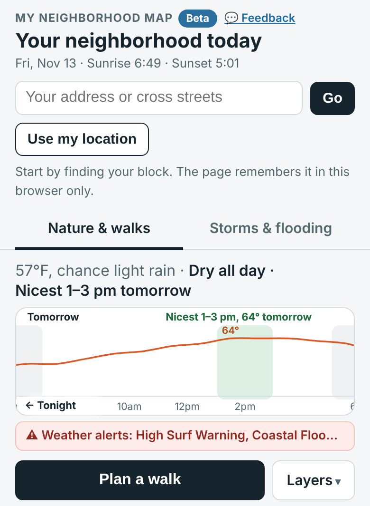

# My Neighborhood Map

My Neighborhood Map: an engine for neighborhood maps, one folder per city. San Francisco is the first city.

## Start here



New here? Welcome. You can help with or without code, and AI coding tools (Claude Code, Cursor and others) are welcome. Live map: **https://christinebuilds.github.io/neighborhood-map/**

**Run it on your computer** (no install, no build step):

```
python3 -m http.server 8931
```

Then open http://localhost:8931/ in your browser. Use your browser's phone view, since most neighbors use the map on a phone.

**Where things live**

| File | What it does |
|---|---|
| `index.html` | The whole map: styles, page and script in one file. Both tabs live here. |
| `cities/sf/city.json` | San Francisco settings: map bounds, data feeds, phone numbers, links, rain notes. |
| `cities/sf/past-storms.json` | Places that flooded in past storms, each with a source link. |
| `flood.html` | Short "SF Flood Map" landing page to share. `today.html` and `walk.html` only redirect. |
| `tools/validate.mjs` | Checks the city files. Run `node tools/validate.mjs` before every pull request. |
| `supabase/migrations/` | Record of the database setup for neighbor reports. Only Christine applies changes. |
| `assets/`, `manifest.webmanifest` | Icons and the link preview picture. |
| `docs/` | Plans and notes. |
| `CLAUDE.md` | Rules for AI coding agents (and a good checklist for people too). |

**Pick a task:** the [features wishlist](https://github.com/christinebuilds/neighborhood-map/issues?q=is%3Aissue+is%3Aopen+label%3Awishlist) has ideas neighbors asked for, each with where to start and how to test. New to this? Try one labeled [good first issue](https://github.com/christinebuilds/neighborhood-map/issues?q=is%3Aissue+is%3Aopen+label%3A%22good+first+issue%22). Comment "I'll take this" to claim it, then read [CONTRIBUTING.md](CONTRIBUTING.md).

**Not an official city service.** This map is made by neighbors. It is not a warning system. In an emergency call 9-1-1. Report flooding to the city at 3-1-1.

<br clear="right">

## What the map does

It is one page with two views of your own block:

- **Nature & walks** (the front door): find your address and the page names your neighborhood. A day strip shows sunrise, sunset, rain hour by hour, temperature and the best two hours for a walk. The map shows street trees (a density picture when zoomed out, single trees when zoomed in) and wildlife neighbors photographed nearby (iNaturalist). Tap a tree or sighting for a small card and "Walk here" for a walking route, what you will pass, and short detours. A seasonal walk (fall colors, blossom) paints the trees in season.
- **Storms & flooding**: the city's flood zone, places that flooded in past storms (with sources), 311 flooding and drain cases, storm drains with a rule-of-thumb flag for which to check first, and neighbor reports ("water here", "I cleared this drain", "needs clearing", "the water is gone"). Each drain keeps a log of clearings and a way to thank the neighbor. Rain amounts, alerts, the next high tide and live rain radar sit alongside.

This is not an official city service or a warning system. In an emergency call 9-1-1. Report flooding to the city at 3-1-1.

## Pages and links

- `index.html` is the map. `#flood` opens the Storms & flooding view, `#walk` starts planning a walk, `#feedback` opens the bug and idea form.
- `flood.html` is a short landing page titled "SF Flood Map", the link to share for flooding.
- `today.html` and `walk.html` only redirect to the map, so old links keep working.
- `version.txt` holds the build time. The page shows it in the footer and offers to update when a newer one is published.

## Cities

Everything local lives in `cities/<id>/`: `city.json` (bounds, data sources, phone numbers, notes) and `past-storms.json`. The engine loads `cities/sf/` by default; add `?city=<id>` to the address to load another folder. San Francisco is the only city for now; other cities are on hold.

## Help improve it

See [CONTRIBUTING.md](CONTRIBUTING.md). Adding a spot in your neighborhood takes one small edit to `cities/sf/past-storms.json`, or you can fill in an issue form with no coding at all. Not a coder? Tap **💬 Feedback** at the top of the map.

Everyone taking part follows the [Code of Conduct](CODE_OF_CONDUCT.md).

## How it is built

One static engine page (`index.html`) with Leaflet and no build step, plus one settings folder per city under `cities/`, published with GitHub Pages. All links between pages are relative, so the site works under any repository name. Neighbor reports are stored in Supabase; notes and photos are checked automatically before they appear.
